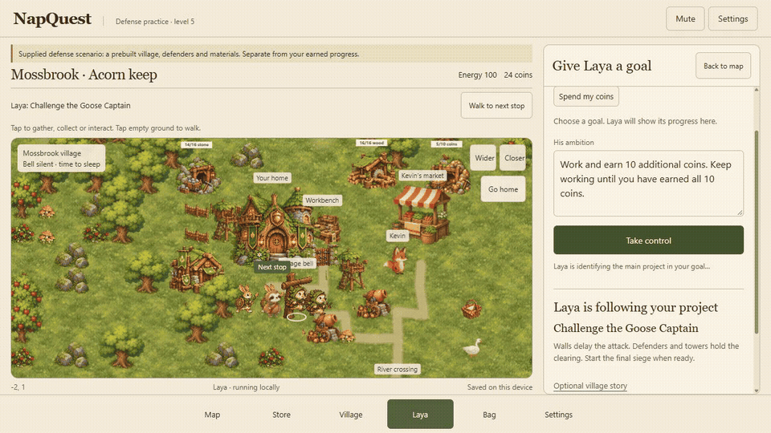

> **Online demo, added October 27 after the Week 3 submission:** [Play NapQuest](https://adkbbx-napquest.hf.space/play/). Manual play works without model calls. Laya uses a shared free GPU and can pause at the guest limit. For unrestricted AI play, run the local version below. Online goals are sent to the server; your village saves in your browser.

# NapQuest: the quiet woods

A playable 2D woodland sandbox starring Mallow, a sloth who would like the village bell to stop. Gather wood, mine stone, forage, plant berry bushes, build cabins and workbenches, trade with Kevin, and repair the river crossing. Accept free honey and three bee coworkers escort one shift, then return after work or when you go home. Steal a picnic and the goose pursues you on the map.



[Judge quickstart](submission/JUDGE_QUICKSTART.md) · [Watch the MP4 demo](submission/media/laya-gameplay.mp4)

Open [the game](http://127.0.0.1:8788/) while the local server is running. Restart with `./start.ps1` from this directory. Setup on another computer uses `./setup.ps1` first. The pinned local model needs several GB of disk and memory; no paid API key is required.

Move with WASD or arrows. Tap a tree, rock, forage item or stocked mine to walk over and gather in one action. Tapping home starts a short nap and wakes automatically. Markets, jobs and paid repairs show choices before spending or accepting. Press E to repeat a selected action. The map stays in view; Store, Village, Laya, Bag and Settings open separate panels. Phones use tap-to-walk; optional movement buttons are in Settings. A next-step guide points to the resource or landmark you currently need. Building and planting have a placement preview and confirmation. Gardens grow berries; watchtowers fire acorns at goose raiders; palisades block paths. Home upgrades consume wood, stone and coins, up to level 5. Raids begin only when requested and pay rewards once. Boars can breach walls and gates, which need rebuilding. Other buildings and home progress survive defeat. A workbench offers crafting recipes.

The five-step story ends after silencing the bell and taking a new nap inside the home. Earlier naps in an upgraded bedroom recharge energy without completing the bell story. The ringing bell wakes him before it is fixed; fitting the muffler stops its visible ringing and optional sound. The bedroom is an illustrated interior with an automatic countdown and an optional early wake-up control. Settings offers 5, 7 or 10 seconds, with 7 seconds as the default. Play continues afterward. Terrain and resource objects generate in seeded 16-by-16 chunks as you explore. The browser saves inventory, position, edits, planting, home/sleep state, and story progress automatically. New world replaces that browser save. The footer offers a separate practice story at `?practice=1`, which preserves the main woodland. Saves are local to this device and browser.

Choose **Home level 5**, **Explore safely**, **Earn 10 coins**, or **Spend my coins**, then **Let Laya take over** to watch actual local model decisions. Laya first identifies the project and target level, then chooses among legal actions that advance it. Upgrade projects gather, sell berries for money, refuel, sleep and continue until the target. Goals and automatic play survive reloads. This is constrained project planning, not a guarantee of the globally optimal route. Manual movement or a map click hands control back to you. Laya chooses high-level actions from current legal options; authored rules apply the consequences and story text. This does not generate a new story, new art, or arbitrary Minecraft mechanics at runtime. Model errors pause automatic play, and manual exploration remains available.

The model is [convaiinnovations/laya](https://huggingface.co/convaiinnovations/laya), pinned to revision `7b928d828b7b0e022f929d9bd2e44165aa270148`. It runs offline after setup. The map uses a reusable painted asset kit, rather than a single background illustration. Mallow, Kevin, the goose and bees use layered 2D cutout skeletons with eased poses. The new defenders and enemy types use complete painted sprites with eased body motion. See [implementation and limits](OPEN_WORLD.md) and [original art records](ART_AND_RIGS.md).

## Verify

```powershell
node --test test-open-world.mjs test-interactions.mjs test-settlement.mjs test-rig.mjs test-world.mjs test-progression.mjs test-play-ux.mjs test-agent-tasks.mjs test-reported-bugs.mjs test-bridge-goal.mjs test-activity-fullscreen.mjs
node --check web/explore.js
./.venv/Scripts/python.exe -m unittest test_engine.py test_service.py
```

These cover seeded generation, negative coordinates, persistence, the complete story, resource costs, collision, bridge routing, jobs, trading, rig crops, attachment hierarchy, easing, reduced motion, and HTTP validation/failure behavior. The HTTP tests use explicit adapters. `evidence/open-world-real-run.json` records a separate browser playthrough that completed the story using real local Laya decisions.

The [original seven-decision adventure](http://127.0.0.1:8788/storybook.html) remains available, with recording playback and its original journal. Its controls and evaluation history are in [STORYBOOK.md](STORYBOOK.md).

## Audio

ElevenLabs Sound Effects v3 generated 21 recordings: a 20-second forest loop plus footsteps, chopping, mining, geese, bees, door, coins, cloth, reward, bell, construction, cannons, slingshots, shield impacts, wall impacts and collapse, troop readiness, resource collection, boars and eating. These are local MP3 assets, not runtime paid API calls. Each session starts muted; choose Unmute to hear audio. Effects and ambience toggle separately and mute when the page is hidden. The manifest in `web/assets/audio/manifest.json` records prompt summaries and durations. Public Explore sharing was disabled during generation. Procedural fallback covers unavailable recordings and the whistle.

`node verify-world-goals.mjs` checks real local Laya spending, exploration, upgrade and low-energy choices. `node verify-home-project.mjs` replays a fresh world through home level 5 with real Laya decisions and no resource grants. It writes `evidence/home-project-five-level-replay.json`; the current recorded run reached level 5 after 40 world actions. This replay uses domain movement and rest transitions, not browser animations.

## Five-level village chapter

Each home level has a unique painted appearance. Level 2 unlocks wood and stone production, walls, friendly gates and towers. Level 3 adds gold mines, barracks and rabbit guards, with boar raiders. Level 4 adds cannons, hedgehog rangers and fox bandits. Level 5 increases the defender camp to eight and unlocks the Goose Captain siege. Defeating the Captain earns a persistent crest beside home. See [chapter controls and limits](LEVEL_FIVE.md).

Choose an unlocked building, select nearby empty ground, then confirm **Place here**. Walls remain selected for consecutive placement. Select a damaged structure to repair it for one wood and one stone, or dismantle it for half its material cost. Mines produce capped stock during active play; **Visit** walks to the building, then **Collect** transfers its stock. Build barracks and use the training controls to recruit defenders. Laya can also build, recruit, shop, craft, plant, clear obstacles, repair, move assets and dismantle through the same game rules. Give it one primary goal at a time; it collects prerequisites before acting.

[Try the supplied level-five siege](http://127.0.0.1:8788/?defense=5) for a separate prebuilt practice village. It has explicitly supplied materials and units and does not replace earned progress.

## Map controls, store and settings

**Mute / Unmute** is always in the top bar. Each session starts muted; effects and ambience preferences are remembered. Settings also separates effects and ambience. The game uses the viewport height, with bottom navigation on phones and scrollable panels rather than a long page.

Store sells structures for coins, useful artifacts and supplies. Choose a structure, select nearby empty ground, then confirm its preview; coins are charged only on successful placement. Material crafting is still available under the Store's material recipes. Work gloves add one wood or stone per gathering action. The trail compass finds nearby resources from Bag. Owned artifacts persist and cannot be purchased twice.

**Settings → Layout** moves home, buildings and woodland assets without paying again. Choose an asset from the list or enter Edit village layout and tap an asset. Choose empty dry ground, then Move here. Drag to pan, or use arrows and Enter to preview at the editor center. E confirms the preview. Done editing exits; Undo last move works during the current session. The river crossing stays fixed. Layout checks preserve village entrances, block editing during sleep and raids, and keep moves within 18 steps of home. Moving home updates raids, defenders, signs, Laya destinations and return-energy budgets. Save version 4 adds locations and artifacts and migrates older saves.

`node --test test-play-ux.mjs` verifies relocation and persistence, route updates, real store costs and refunds, working artifacts, timed naps and mute persistence before audio unlock. Existing game regressions also pass.

### Additional Laya goals and land clearing

Examples: `Earn 10 coins`, `Build a quarry`, `Train 2 guards`, `Gather 10 wood`, `Buy work gloves`, `Craft a muffler`, `Plant 3 seeds`, `Clear a stump`, `Repair my walls`, or `Move my home near the market`. Laya selects an intent, then legal actions in small groups. Action and quantity recognition can still misunderstand ambiguous requests; inspect the progress label before leaving it running. Impossible actions pause with a reason. Earn goals count new income from jobs, sales, gold collection and raid wins; opening coins and building refunds do not count.

Tap a stump to clear it for one wood, or choose **Sit and rest instead**. Clearing permanently frees the tile; construction still checks terrain, entrance access, level, price and distance. `node --test test-agent-tasks.mjs` checks these action contracts. `node verify-agent-tasks.mjs` exercises real local Laya separately from browser saves.

## Post-submission hosting work

On 26 October 2026, after the Week 3 deadline, public-host support was added separately from the original submitted game. The original submission snapshot is commit `d016d05a86b9077f485b8c35b514673339389202`. See [hosting setup and verification status](HOSTING.md). The free ZeroGPU deployment is now live. Its manual game and real Laya decisions were verified on October 27; long AI goals can pause at the guest GPU limit.

## Latest playability updates

The hosted game includes fullscreen entry and exit, compact notices and controls below the map, and a persistent Laya activity line. Completed goals stay visible with a New goal button. Sound starts muted each session.

Bridge repair is a dedicated goal: gather 4 wood and 2 stone, repair the crossing, then stop. The crossing has its own sign instead of a stump sprite. Bee escorts expire after 30 seconds and do not restart on repeat honey collection after a completed shift.

Hosted decisions time out after 30 seconds; taking control cancels queued requests. Free GPU quota errors pause automatic play, while manual play remains available.

The current gameplay suite passes 61 tests. `evidence/bridge-goal-real-laya.json` records a complete local Laya bridge run; `evidence/fullscreen-status-release.json` records verification against the deployed Hugging Face files. To repeat the real-model check, start `python app.py --port 8792`, wait for model readiness, and run `node verify-bridge-goal.mjs`.
