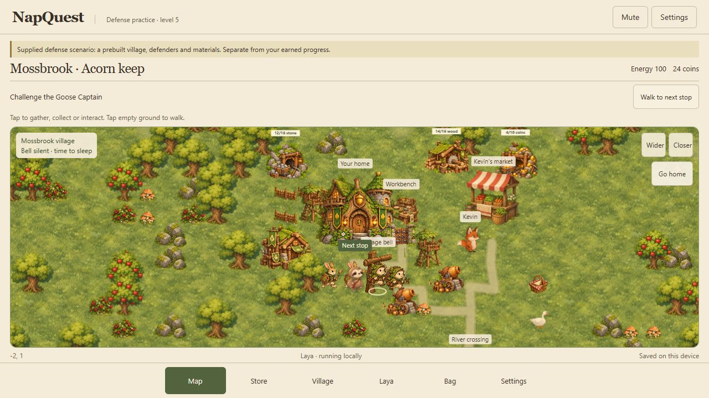
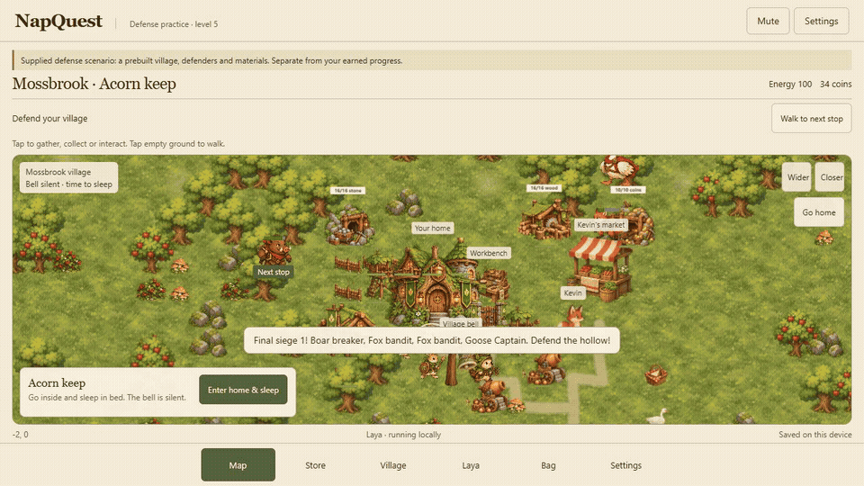
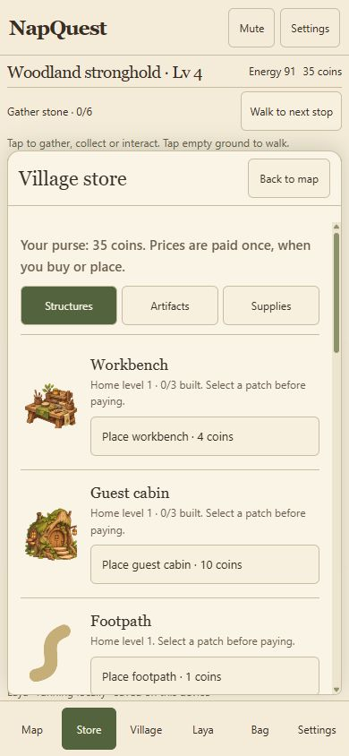

*This is a submission for the [Hacktoberfest Open-Source AI Challenge Week 3: Slow and Steady](https://dev.to/challenges/hacktoberfest-week3-2026-10-19).*

For the past three weeks, I've been building fairly serious apps for these challenges. There was one for [getting through phone calls in Japan](https://dev.to/adk_bbx/phone-calls-are-the-boss-fight-of-living-in-japan-1h6h), one for [working out whether junk mail was worth a walk](https://dev.to/adk_bbx/i-asked-my-junk-mail-one-question-are-you-worth-the-walk-41p8), and last week's [tool for finding a product's first customers](https://dev.to/adk_bbx/building-software-got-easy-finding-the-first-customer-didnt-398i).

This week I wanted to make something fun and light. The prompt was about laziness, so a sloth seemed like a reasonable place to start.

I called him Mallow. He lives in a woodland village, and his first problem is a bell that won't let him sleep. Somehow this turned into gathering wood, taking a job with bees, building a better house and defending it from geese.

I also wanted to be able to stop doing all the little jobs myself. That's where Laya comes in.

## What I built

NapQuest is a small village-building game. You can play it yourself, or give Mallow a goal and let a local AI choose what he does next.

If I ask him to earn ten coins, he can find work or gather berries to sell. If I ask him to upgrade his home, he has to get the materials, pay for the upgrade and keep himself fed along the way. I can take control again whenever I want.

*This is the supplied level-five practice village. It has its own save and prepared resources so you can try the later parts of the game.*

The first versions weren't very entertaining. Mallow would walk around while the journal told me what had happened. If a goose was supposed to be chasing him, I wanted to see the goose chasing him. The same went for the bees. Reading about a consequence wasn't enough.

Now stealing a picnic starts a chase on the map. Taking a honey job brings bee coworkers along for a shift. Trees leave stumps you can clear for building space. A nap takes a few seconds and ends with Mallow coming back outside, ready to continue.

The village has five home levels, with a different building at each level. You can add resource mines, plant food, buy tools and train defenders. Walls and gates slow enemies down while watchtowers and acorn cannons fire at them. The last fight is against the Goose Captain.

*A recording of the practice siege. The prepared defenses win this run and earn the Acorn crest.*

## Demo

*This shows the first 24 seconds of a local Laya run, followed by its later completion. The practice world supplies the starting village. The recording is silent.*

The game currently runs locally with Python and a browser. Once you've downloaded the model, you can run it offline. To try automatic play, open Laya, choose "Earn 10 coins" and select "Let Laya take over." Clicking the map gives control back to you.

## Code

The source package includes the browser game, Python model adapter, setup scripts, tests and the decision records from the runs below. The application code is MIT licensed. The model downloads separately during setup.

## How I built it

I used [Convai Innovations' Laya](https://huggingface.co/convaiinnovations/laya), an open-weight decision model, running on the CPU. The build pins model revision `7b928d828b7b0e022f929d9bd2e44165aa270148` so I can repeat tests against the same checkpoint.

Laya chooses from a set of described actions. The game works out which actions are legal, sends those choices to the model and carries out its answer. Movement, resource costs and combat follow the game's rules. The model chooses what to attempt; the game checks whether it can happen.

One bug was especially annoying. Asking Mallow to earn money didn't work because earning wasn't a proper goal type yet. I added that goal and a counter for new income, rather than checking how much money was already in his wallet. I also had to split crowded action descriptions into smaller questions. Moving home near the market needed separate questions for what to move and where to put it.

The browser game uses JavaScript, HTML and Canvas. Terrain generates in seeded chunks as you explore, and browser storage saves your inventory and changes to the village. The painted characters use layered cutout animation. The added combat units use simpler whole-sprite movement.

Sound made a big difference. I used my ElevenLabs subscription to generate 21 recordings for the forest, footsteps, chopping, mining, doors, bees, goose honks and combat. The game plays those files locally. I added separate controls for ambience and effects, plus a mute button in the header.

*The phone layout keeps the map and controls on one screen. Store, Bag, Village and Settings open as panels. You can tap objects to gather or interact instead of finding an action at the bottom of a long page.*

## Why does open innovation matter?

I wanted to put the model in the game loop without charging for every decision. With Laya running locally, I can leave a goal going without a hosted inference bill. The player's requests stay on their machine.

It also made debugging practical. I could save the available choices and the model's answer, change an action description and run the same situation again. There is still a setup download and some waiting for CPU inference, and Laya can misunderstand a request. The game handles one main goal at a time.

## The lazy payoff

In one fresh-world test, I gave Laya the home-level-five goal and it completed it in 40 world actions without supplied resources. A separate run earned ten new coins in 33 actions. Those are recorded runs, rather than a promise that every goal will take the same route.

That's the part I wanted from this project. I can do the gathering and building when I feel like playing, or give Mallow a job and watch him work through it.

The current build passes 48 gameplay tests and nine Python tests. I've also checked the game in the browser, including purchases, moving home, clearing stumps, automatic waking and a ten-coin goal that stopped when it was finished. There is more I'd like to do with the story, but this version has the bell-and-nap quest, the five-level village and the goals you set yourself.

## Prize categories

I'm entering Best Use of ElevenLabs for the generated game audio. The repository's audio manifest lists the recordings and the prompts used to make them. The files were generated during development and are included with the game.

*I used AI coding and image-generation tools while building NapQuest, and ElevenLabs for the audio. I directed the build, tested the game and kept revising the parts that weren't fun. AI also helped prepare this post.*
